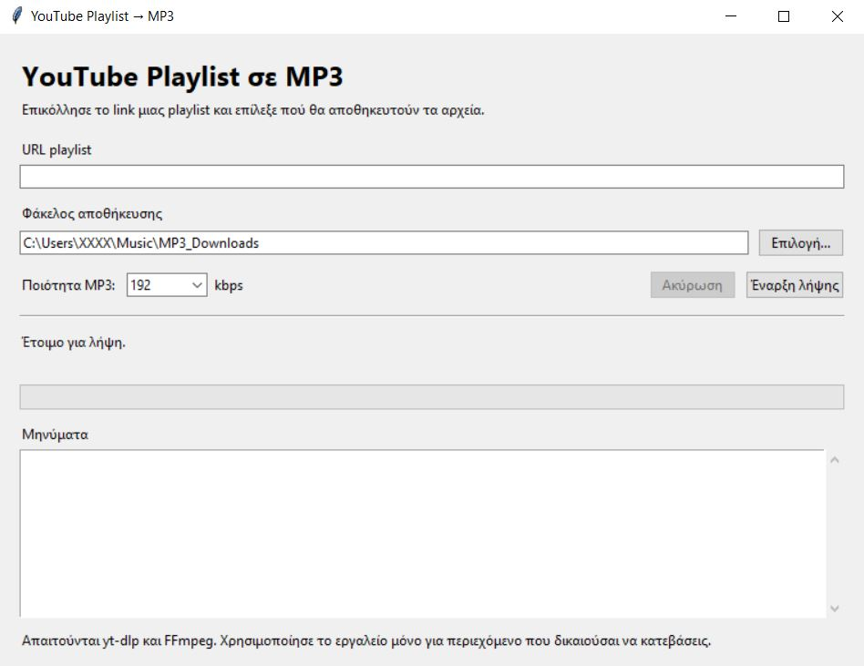

# YouTube Playlist to MP3

A simple Python tool to extract audio from YouTube playlists and save it as MP3 files. Includes both a command-line version and a graphical user interface (GUI).

## Features

- **Two versions:** Command-line interface (CLI) and graphical user interface (GUI).
- **Playlist support:** Process playlists containing multiple videos.
- **MP3 conversion:** Extract audio and convert it to MP3 using FFmpeg.
- **Audio quality:** Choose a bitrate of 128, 192, 256, or 320 kbps in the GUI. The CLI version uses 192 kbps by default.
- **Organized filenames:** Prefix downloaded files with their playlist position.
- **Error handling:** Continue past individual download errors where possible.
- **Download history:** Keep an archive of completed downloads to avoid downloading the same entries again.
- **Folder selection:** Choose an output directory in the GUI.

## Project Structure

```text
playlist-to-mp3/
├── playlist_to_mp3.py
├── playlist_to_mp3_gui.py
├── README.md
└── MP3_Downloads/          # Created when the scripts run
```

Make sure both Python scripts are present in the project directory if you want to use both versions.

## Requirements

- Python 3.10 or newer recommended
- [yt-dlp](https://github.com/yt-dlp/yt-dlp)
- [FFmpeg](https://ffmpeg.org/)
- Tkinter for the graphical interface (usually included with standard Python installations)

## Installation

### 1. Install Python

Download Python from [python.org](https://www.python.org/downloads/).

On Windows, enable **Add Python to PATH** during installation if that option is available.

### 2. Install yt-dlp

Open a terminal in the project directory and run:

```bash
python -m pip install -U yt-dlp
```

Using `python -m pip` helps ensure that the package is installed for the Python interpreter you intend to use.

### 3. Install FFmpeg

FFmpeg is required to convert downloaded audio to MP3.

**Windows:**

```powershell
winget install Gyan.FFmpeg
```

**macOS (Homebrew):**

```bash
brew install ffmpeg
```

**Ubuntu / Debian:**

```bash
sudo apt update
sudo apt install ffmpeg
```

Restart your terminal after installation, then verify that FFmpeg is available:

```bash
ffmpeg -version
```

If the command is not recognized, check that FFmpeg is installed and available on your system's PATH.

## Usage

### Option 1: Command-Line Version (CLI)

Run the script:

```bash
python playlist_to_mp3.py
```

When prompted, paste the URL of the playlist you want to process.

The script creates an `MP3_Downloads` directory in the current working directory and saves the converted files there.

Example filenames:

```text
MP3_Downloads/
├── 001 - Example Song One.mp3
├── 002 - Example Song Two.mp3
├── 003 - Example Song Three.mp3
└── downloaded.txt
```

The CLI version uses a default MP3 bitrate of 192 kbps.

### Option 2: Graphical User Interface (GUI)

Run the GUI script:

```bash
python playlist_to_mp3_gui.py
```

The application provides:

1. A field for the YouTube playlist URL.
2. A folder selector for the output directory.
3. An MP3 bitrate selector.
4. A download button.
5. A cancellation button.
6. A progress bar and current-file status.
7. A log area for messages and errors.

Select your preferred settings and click **Start Download** (Έναρξη λήψης in the Greek-language interface).

The default output directory is `MP3_Downloads` inside your user's Music folder.

## Configuration

### Audio Quality

The GUI supports the following MP3 bitrates:

| Bitrate | Description |
|---|---|
| 128 kbps | Smaller files |
| 192 kbps | Balanced file size and quality |
| 256 kbps | Higher bitrate |
| 320 kbps | Maximum supported output bitrate |

The CLI script uses 192 kbps by default.

**Note:** Converting audio to a higher bitrate does not improve the quality of the original source audio.

### Download Archive

Both scripts use a file named `downloaded.txt` to keep track of completed downloads.

This archive helps prevent the same playlist entries from being downloaded again when the script is run later.

If you want to download entries again, back up the archive and remove or rename `downloaded.txt`. Existing MP3 files are not automatically deleted.

## Troubleshooting

### `ModuleNotFoundError: No module named 'yt_dlp'`

Install `yt-dlp` using the same Python interpreter that runs the script:

```bash
python -m pip install -U yt-dlp
python playlist_to_mp3_gui.py
```

On Windows, `python` and `py` may point to different Python installations. Check the interpreter paths with:

```bash
python -c "import sys; print(sys.executable)"
py -0p
```

### `FFmpeg was not found`

Install FFmpeg and make sure it is available on your system's PATH. Restart the terminal after installation.

### Some playlist entries fail

Some videos may be unavailable, private, region-restricted, removed, or otherwise inaccessible. Update yt-dlp and try again:

```bash
python -m pip install -U yt-dlp
```

### The progress bar does not show the entire playlist's progress

The progress bar reports the download progress of the current file, not the percentage of the entire playlist completed.

## Legal and Responsible Use

This project is intended for personal use with content you own or are otherwise authorized to download.

- Respect copyright and the rights of content creators.
- Follow YouTube's Terms of Service and applicable local laws.
- Do not use this software to download copyrighted content without permission.
- You are responsible for ensuring that your use of this software is lawful.

This project is not affiliated with, endorsed by, or sponsored by YouTube.

## Limitations

- FFmpeg must be installed separately.
- The scripts require a working Python environment and an internet connection.
- Playlist entries that cannot be accessed will not necessarily be downloaded.
- The GUI is built with Tkinter and uses a basic desktop interface.
- A completed-download archive may cause previously processed entries to be skipped.

## License

Choose a license before publishing this repository. If you want others to freely use, modify, and distribute your code, consider the [MIT License](https://opensource.org/license/mit/).

If you choose MIT, add a `LICENSE` file containing the appropriate license text and your copyright notice.

---

**Built with Python, yt-dlp, and FFmpeg.**

## Preview
